# BookTrack – Kütüphane Ödünç Takip API'si

.NET 8 (ASP.NET Core Web API), Entity Framework Core ve SQL Server ile geliştirilmiş kitap envanteri ve ödünç verme/iade takibi API'si.

 

API ile birlikte gelen web arayüzü (`/`) katalog, ödünç verme, **uzatma**, iade ve geçmiş işlemlerini; **rapor paneli**, **geciken ödünç listesi**, **CSV/Excel dışa aktarma** ve (yönetici için) **denetim kaydını** sunar. API ayrıca Swagger üzerinden denenebilir.


| Rapor paneli | Geciken ödünçler |
|---|---|
| 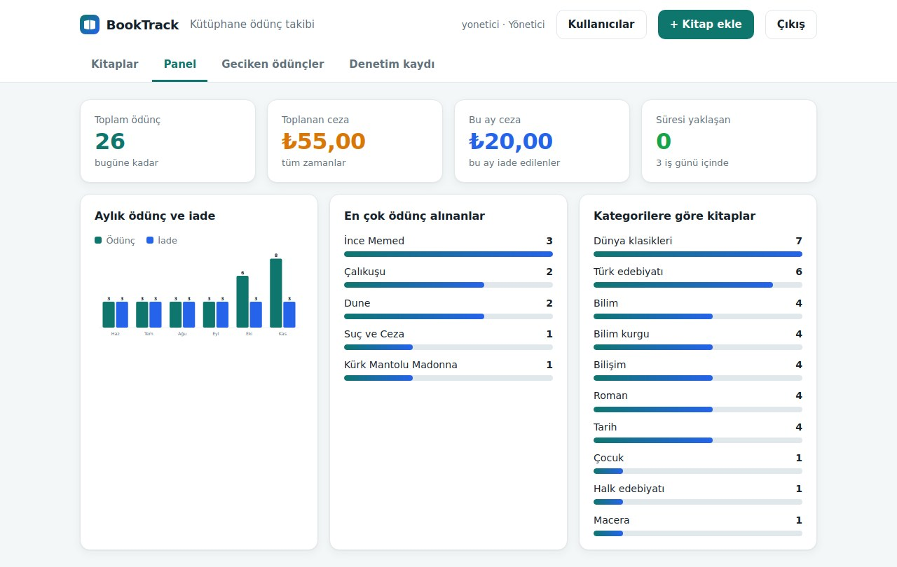 | 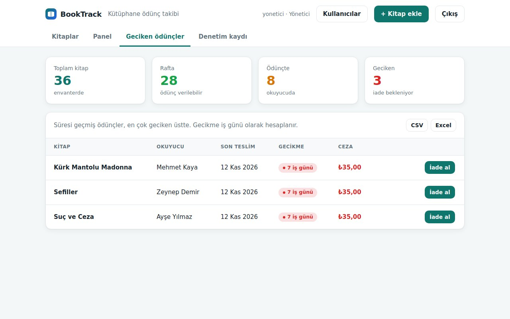 |

## Proje amacı ve çözdüğü problem
Küçük ve orta ölçekli kütüphanelerde (okul, kurum içi arşiv, zimmet benzeri envanter) kitap kimde, ne zaman teslim edilmeli ve gecikmenin bedeli ne kadar sorularının tek yerden, tutarlı yanıtlanması gerekir. BookTrack bunu şu kurallarla sağlar: ödünç süresi ve gecikme cezası **iş günü ve resmi tatile göre** hesaplanır, aynı kitap **aynı anda iki kişiye verilemez** (eş zamanlılık veritabanı düzeyinde korunur) ve **ödünç geçmişi silinemez** (yabancı anahtar ve benzersiz ISBN ile veri bütünlüğü).

## Hızlı başlangıç (Docker)
Gereksinim: Docker. SQL Server ve API birlikte ayağa kalkar, migration'lar otomatik uygulanır. Önce `.env` dosyasını oluşturup JWT anahtarını ve ilk yönetici parolasını doldurun (bunlar olmadan compose başlamaz):
```bash
cp .env.example .env     # JWT_SECRET (en az 32 karakter) ve ADMIN_PASSWORD (en az 8 karakter) zorunlu
docker compose up --build
```
Arayüz: http://localhost:8080 · Swagger: http://localhost:8080/swagger. Giriş için kullanıcı adı `ADMIN_USERNAME` (varsayılan `yonetici`), parola `ADMIN_PASSWORD`. SQL Server `sa` parolasının varsayılanı yerel denemeye yöneliktir; `MSSQL_SA_PASSWORD` ile değiştirilebilir. Veri `sqldata` birimi içinde kalıcıdır (`docker compose down -v` siler).

Docker yerine yerelde çalıştırmak için aşağıdaki [Çalıştırma](#çalıştırma) bölümüne bakın.

## Mimari ve teknoloji yığını
| Katman / bileşen | Seçim | Neden |
|---|---|---|
| API | ASP.NET Core 8 Web API (`Controllers/BooksController`) | Kurumsal ortamlarda yaygın, uzun süreli destekli (LTS) çalışma zamanı |
| İş kuralları | `Services/LoanCalculator` (saf, durumsuz sınıf) | Teslim tarihi, gecikme günü ve ceza hesabı veritabanına ve HTTP'ye bağlı değildir; birim testle doğrudan sınanır |
| Veri erişimi | Entity Framework Core 8 + migration'lar | Şema sürümlenir; geçişler tekrarlanabilir ve testlerde gerçek SQL Server'a karşı doğrulanır |
| Veritabanı | SQL Server (rowversion, unique index, yabancı anahtar) | Eş zamanlılık ve veri bütünlüğü kısıtları veritabanında zorlanır, yalnızca uygulama koduna bırakılmaz |
| Kimlik ve yetki | JWT (HS256) + rol bazlı yetki (`Admin`, `Librarian`), parola özeti `PasswordHasher` (PBKDF2) | Açık kayıt yok, hesapları yönetici açar; her istekte kullanıcı veritabanından doğrulanır, pasife alınan anında reddedilir |
| Doğrulama | Veri açıklamaları + `TcknDogrulayici` | Girdi hataları 400, çakışmalar 409 ile ayrışır |
| Arayüz | Sade HTML/CSS/JS (`wwwroot`), derleme adımı yok | Harici bağımlılık yok; CSP ile satır içi betik/stil kullanılmaz |
| Test | xUnit, `WebApplicationFactory`, gerçek SQL Server testleri | Bellek içi sağlayıcının üretemediği davranışlar (çakışma, kısıtlar, migration) gerçek veritabanında sınanır |
| CI / dağıtım | GitHub Actions (SQL Server servisiyle), Dockerfile + docker-compose | Her push ve PR'da derleme ve tüm testler; tek komutla çalıştırma |

Proje tek bir web projesi ve ayrı bir test projesinden oluşur (`LibraryApp`, `LibraryApp.Tests`). İş mantığı denetleyiciden `Services` altına ayrılmıştır; ancak depo (repository) veya uygulama katmanı yoktur, denetleyici `DbContext`'i doğrudan kullanır. Proje büyürse sıradaki adım bu ayrımın katmanlara bölünmesidir (bkz. [Bilinen sınırlar](#bilinen-sınırlar)).

## Veritabanı şeması
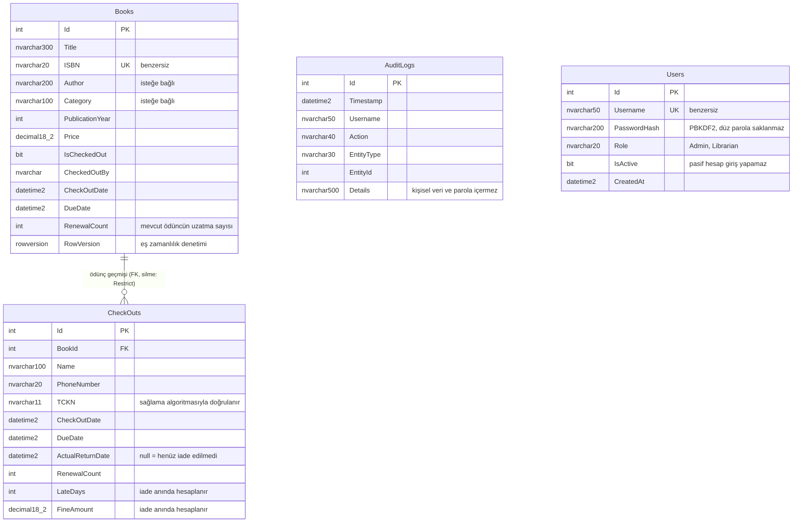
`Users` ve `AuditLogs` tabloları kitap ve ödünç tablolarıyla ilişkili değildir (kimlik doğrulama ve denetim için ayrıdır; denetim kaydına yalnızca ekleme yapılır).
`CheckOuts_Yetim`, `VeriButunlugu` migration'ı sırasında kitabı silinmiş eski kayıtların taşındığı arşiv tablosudur (yalnızca eski veritabanlarında oluşur).

## API belgeleri (Swagger)
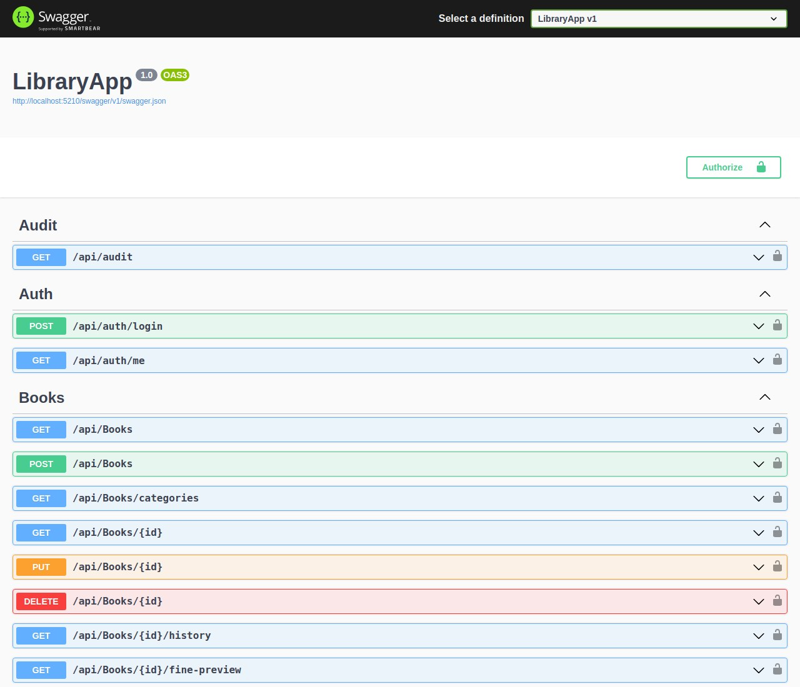

## Web arayüzü
Dosyalar `LibraryApp/LibraryApp/wwwroot` altındadır (sade HTML, CSS ve JavaScript; derleme adımı ve harici bağımlılık yok).

- Üstte özet kartları: toplam, rafta, ödünçte ve geciken kitap sayısı (sunucuda hesaplanır)
- **Sunucu taraflı** arama (başlık, yazar, ISBN), kategori süzgeci, sıralama (başlık, yazar, yıl, fiyat), Tümü / Rafta / Ödünçte / Geciken filtresi ve sayfalama
- Kitap ekleme, düzenleme (yazar ve kategori dahil), silme (ödünçteki kitap silinemez)
- Ödünç verme: ad, telefon, T.C. kimlik no doğrulaması; iade alırken gecikme günü ve ceza önceden gösterilir
- Kitap bazında ödünç geçmişi (kişisel veri göstermez)
- **Ödünç uzatma:** her uzatma 7 iş günü ekler, en çok 2 kez; süresi geçmiş ödünç uzatılamaz
- **Panel:** toplam ödünç, toplanan ve bu ayki ceza, son altı ayın ödünç/iade grafiği, en çok ödünç alınanlar, kategori dağılımı
- **Geciken ödünçler:** gecikme iş günü ve ceza ile, en çok geciken üstte; CSV/Excel indirme
- **Denetim kaydı** (yalnızca yönetici): kim, ne zaman, neyi yaptı; işlem ve kullanıcıya göre süzme, sayfalama
- Mobilde de kullanılabilir, koyu tema desteği

| Giriş ekranı | Kullanıcı yönetimi (yönetici) |
|---|---|
| 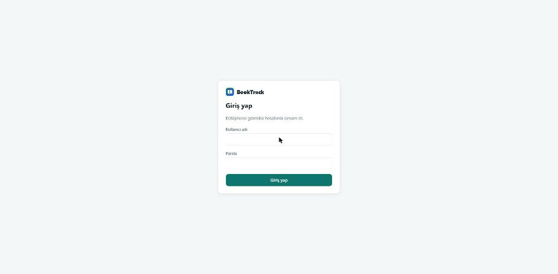 | 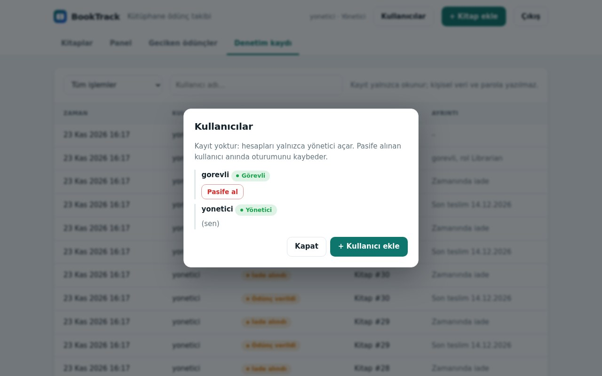 |

| Arama ve sıralama | Ödünç uzatma | Denetim kaydı (yönetici) |
|---|---|---|
| 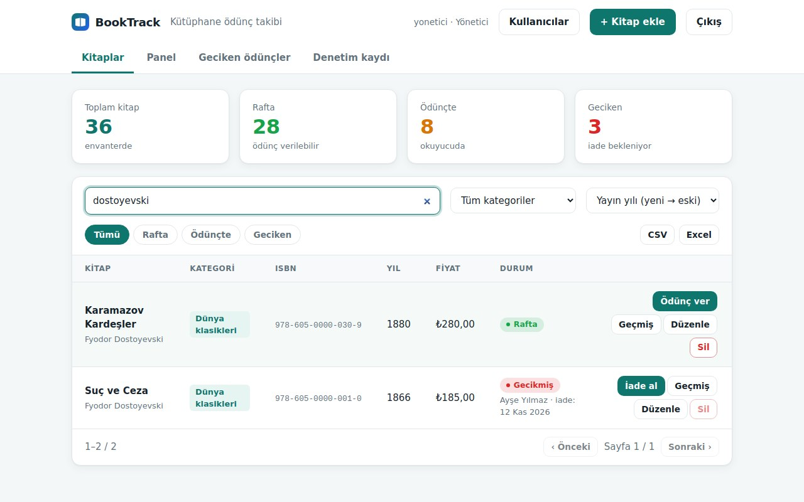 | 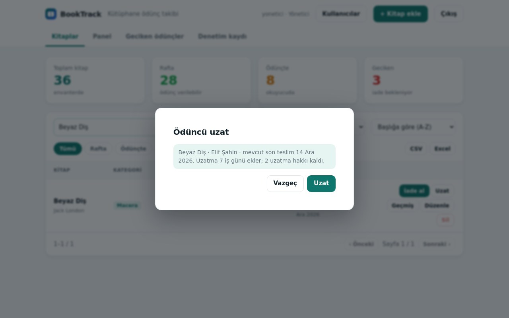 | 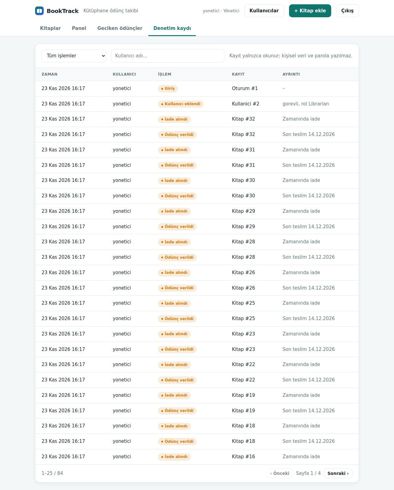 |

Güvenlik: metinler `textContent` ile yazılır (`innerHTML` yok), sayfa `Content-Security-Policy` ile sunulur ve satır içi betik/stil kullanmaz.

| İade ve gecikme cezası | Ödünç verme |
|---|---|
|  | 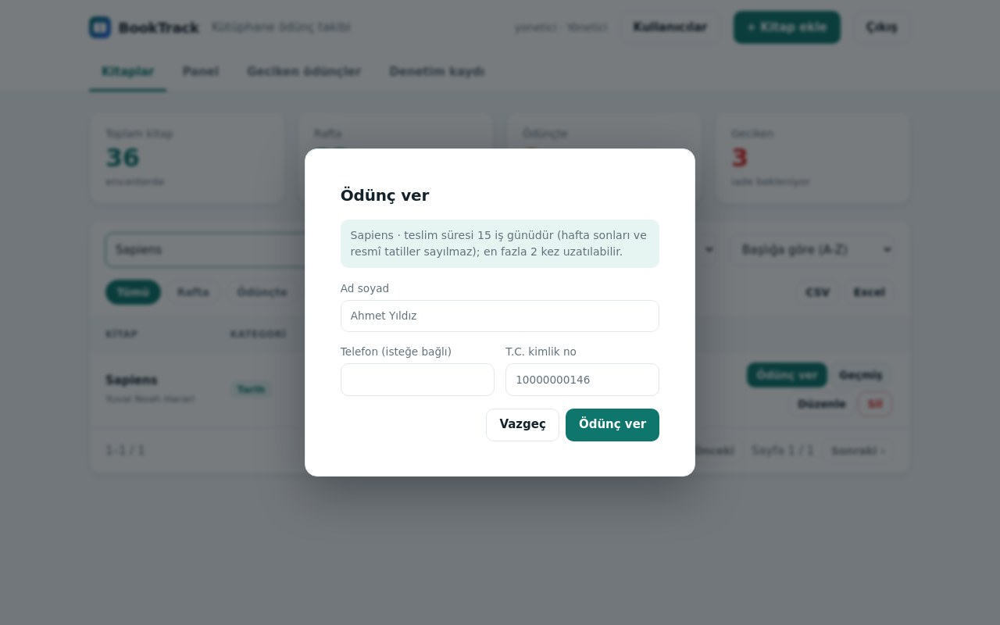 |

| Geciken filtresi | Ödünç geçmişi | Mobil |
|---|---|---|
| 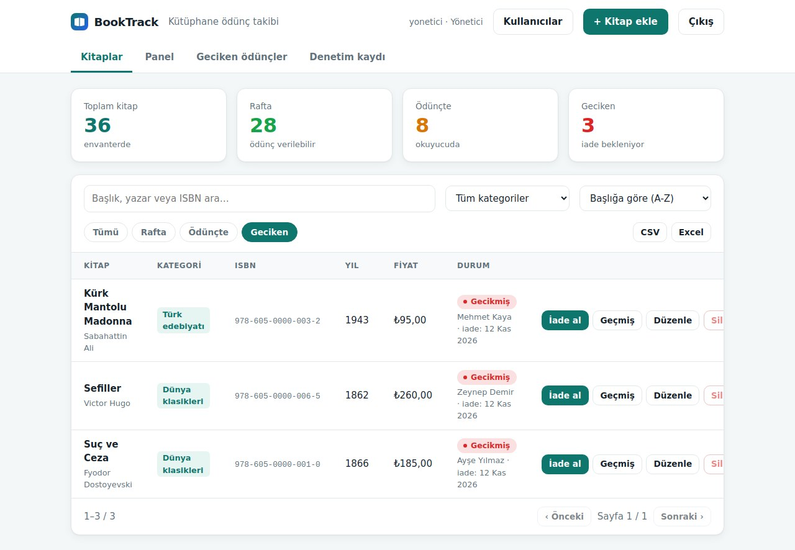 | 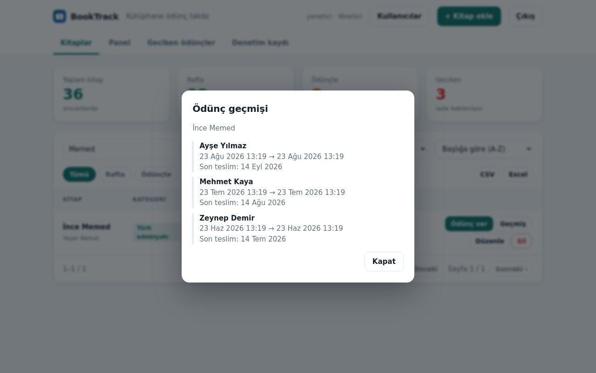 |  |

## Özellikler
- Kitap CRUD (`/api/books`); girdiler doğrulanır (başlık ve ISBN zorunlu, başlık en fazla 300, ISBN en fazla 20 karakter, yayın yılı 1000–2100, fiyat ≥ 0). **ISBN benzersizdir**: aynı ISBN ile ikinci kitap eklenemez veya güncellenemez (409). **Ödünç geçmişi olan kitap silinemez** (409); kayıtlar `CheckOut` → `Book` yabancı anahtarıyla bağlıdır ve geçmiş korunur
- **Ödünç verme** (`POST /api/books/checkout/{id}`): kitap zaten ödünçteyse reddedilir, teslim tarihi **15 iş günü** sonrası olarak hesaplanır (hafta sonları sayılmaz)
- **İade** (`POST /api/books/checkin/{id}`): gecikme iş günü sayısı üzerinden **günlük 5 ₺ ceza** hesaplanır; yanıtta `lateDays` ve `fine` alanları da döner. Son teslim günü içindeki iade zamanında sayılır; hafta sonları ve resmi tatiller ne teslim süresine ne de cezaya dahil edilir
- Ödünç kaydı (CheckOut) geçmişi tutulur; girdiler doğrulanır (ad zorunlu, T.C. kimlik no 11 hane ve resmi sağlama algoritmasına uygun olmalı)
- **Kimlik doğrulama ve roller:** JWT ile giriş (`POST /api/auth/login`, IP başına dakikada 10 deneme). Tüm kitap uç noktaları girişi gerektirir. **Admin**: her şey, kitap silme ve kullanıcı yönetimi dahil. **Librarian (görevli)**: kitap ekleme/düzenleme, ödünç verme, iade ve geçmiş; kitap silemez, kullanıcı yönetemez (403). Açık kayıt yoktur; ilk yönetici açılışta `Auth__AdminUsername`/`Auth__AdminPassword` ile oluşturulur. Pasife alınan kullanıcının elindeki token bir sonraki istekte reddedilir; kullanıcı kendini ve son aktif yöneticiyi pasife alamaz.
- **Katalog:** yazar ve kategori alanları; `GET /api/books` arama (`q`), `category`, `available`, `overdue`, `sort`/`desc` ve `page`/`pageSize` parametrelerini destekler, toplam kayıt sayısı `X-Total-Count` başlığında döner. `page` verilmezse eski davranış korunur (tüm liste).
- **Uzatma** (`POST /api/books/{id}/renew`): her seferinde `Library:RenewalBusinessDays` (7) iş günü eklenir, en çok `Library:MaxRenewals` (2) kez; süresi geçmiş ödünç 409 ile reddedilir. İade ve yeni ödünç sayacı sıfırlar.
- **Raporlar** (`/api/reports`): özet (sayılar, ceza toplamı, aylık ödünç/iade, en çok ödünç alınanlar, kategori dağılımı), geciken ödünçler (gecikme iş günü ve ceza ile) ve **CSV/Excel dışa aktarma** (kitaplar, ödünçler, geciken ödünçler). Excel dosyası ek paket olmadan üretilir; CSV, formül enjeksiyonuna karşı korumalıdır. Dışa aktarmalarda TCKN ve telefon yer almaz.
- **Denetim kaydı** (`GET /api/audit`, yalnızca Admin): giriş ve başarısız giriş, kitap ekleme/güncelleme/silme, ödünç, uzatma, iade, kullanıcı yönetimi ve dışa aktarma. Kişisel veri ve parola yazılmaz; salt ekleme, güncelleme/silme uç noktası yoktur.
- EF Core migration'ları, Swagger UI (geliştirme ortamında; sağ üstteki **Authorize** ile token girilir)

## Uç noktalar
| Yöntem | Yol | Yetki | Açıklama |
|---|---|---|---|
| POST | `/api/auth/login` | herkese açık | JWT alır (kullanıcı adı + parola) |
| GET | `/api/auth/me` | giriş yapmış | Oturumdaki kullanıcı ve rolü |
| GET/POST | `/api/users` | Admin | Kullanıcıları listele / ekle (rol: `Admin` veya `Librarian`) |
| POST | `/api/users/{id}/deactivate`, `/activate` | Admin | Kullanıcıyı pasife al / etkinleştir |
| GET | `/api/books` | Admin, Librarian | Listele; `q`, `category`, `available`, `overdue`, `sort`, `desc`, `page`, `pageSize`; toplam `X-Total-Count` başlığında |
| GET | `/api/books/{id}`, `/api/books/categories` | Admin, Librarian | Getir / kategori listesi |
| POST | `/api/books` | Admin, Librarian | Kitap ekle |
| PUT | `/api/books/{id}` | Admin, Librarian | Güncelle |
| DELETE | `/api/books/{id}` | **Admin** | Sil |
| POST | `/api/books/checkout/{id}` | Admin, Librarian | Ödünç ver (gövde: ad, telefon, TCKN) |
| POST | `/api/books/checkin/{id}` | Admin, Librarian | İade al, gecikme günü ve cezayı döndür |
| GET | `/api/books/{id}/fine-preview` | Admin, Librarian | İade edilirse şu an uygulanacak gecikme günü ve ceza (iade etmeden önce gösterilir) |
| GET | `/api/books/{id}/history` | Admin, Librarian | Ödünç geçmişi (ad, tarihler, uzatma, gecikme ve ceza; TCKN ve telefon dönmez) |
| POST | `/api/books/{id}/renew` | Admin, Librarian | Ödüncü 7 iş günü uzat (en çok 2 kez, gecikmiş ödünç uzatılamaz) |
| GET | `/api/reports/summary` | Admin, Librarian | Özet sayılar, ceza, aylık seri, en çok ödünç alınanlar, kategori dağılımı |
| GET | `/api/reports/overdue` | Admin, Librarian | Geciken ödünçler (gecikme iş günü ve ceza) |
| GET | `/api/reports/export/{books\|loans\|overdue}?format=csv\|xlsx` | Admin, Librarian | CSV / Excel dışa aktarma |
| GET | `/api/audit` | **Admin** | Denetim kaydı (`action`, `user`, `page`, `pageSize`) |

## Çalıştırma
Gereksinimler: .NET 8 SDK ve SQL Server (varsayılan bağlantı: `(localdb)\mssqllocaldb`, Windows'ta Visual Studio ile gelir).
```bash
cd LibraryApp/LibraryApp
dotnet ef database update      # veritabanını oluşturur (dotnet tool install --global dotnet-ef)
export Auth__AdminUsername=yonetici Auth__AdminPassword=<en-az-8-karakter>   # ilk yönetici (PowerShell: $env:Auth__AdminPassword = '...')
dotnet run                     # Arayüz: http://localhost:5210  ·  Swagger: /swagger
```
Geliştirme ortamında JWT anahtarı `appsettings.Development.json` içindeki yalnızca geliştirmeye özel değerdir; **üretimde `Jwt__Secret` (en az 32 karakter) ortam değişkeniyle verilmelidir, yoksa uygulama başlamaz**. Giriş ekranı `/` adresindedir.

Örnek kitap ve ödünç kayıtlarıyla denemek için uygulama çalışırken: `ADMIN_USERNAME=... ADMIN_PASSWORD=... node scripts/demo-verisi.mjs` (Node 18+; yönetici bilgileri yukarıda verdikleriniz; ISBN'ler örnek değerlerdir).

```bash
dotnet test LibraryApp/LibraryApp.sln   # 181 test (SQL Server testleri BOOKTRACK_TEST_SQL tanımlı değilse atlanır)
```
**Resmi tatiller** `appsettings.json` içindeki `Library:Holidays` listesinden okunur (yyyy-MM-dd); 2026 tatilleri tanımlıdır. Listede olmayan bir yıl için tatiller iş günü sayılır, bu yüzden her yıl başında güncelleyin.

Farklı bir SQL Server için `ConnectionStrings:DefaultConnection` değerini değiştirin.

## Testler
xUnit ile 181 test: kimlik doğrulama ve yetki (kimliksiz istek 401, sahte/bozuk/yabancı anahtarlı token reddi, rol kısıtları, pasife alınan kullanıcının token'ının anında geçersiz olması, kendini/son yöneticiyi pasife alma engeli, giriş hız sınırı, anahtarsız başlatmama), ödünç süresi ve gecikme hesabı (hafta sonu, resmi tatil ve sınır durumları, `LoanCalculator`), kitap doğrulaması, ödünç verme/iade akışı, gecikme cezası, ödünçteki ve geçmişi olan kitabın silinememesi, ISBN tekrarı, alan uzunlukları, T.C. kimlik no algoritması, geçmiş uç noktasının kişisel veri sızdırmaması ve arayüzün güvenlik başlıkları (`WebApplicationFactory` + bellek içi veritabanı). **Yeni özellikler:** arama, süzgeç, sıralama ve sayfalama (sınır değerleri dahil), yazar/kategori doğrulaması, ödünç uzatma (iş günü hesabı, hak sınırı, gecikmiş ödünç, sayaç sıfırlama), rapor özeti ve geciken listesi (ayarlanabilir sahte saatle gerçek zaman beklenmeden), CSV/Excel çıktısı (BOM, tırnaklama, formül enjeksiyonu, geçerli xlsx paketi, XML kaçışı), denetim kaydının kapsamı, yetkisi ve kişisel veri sızdırmaması. **Eş zamanlılık:** aynı kitap aynı anda birden fazla kişiye ödünç verilemez. `Book` kaydında SQL Server `rowversion` sütunu vardır; çakışan istekten yalnızca biri başarılı olur, diğeri 409 (veya kitap artık ödünçte olduğu için 400) alır ve reddedilen isteğin ödünç kaydı yazılmaz. Bu davranış, unique index, yabancı anahtar ve veri taşıyan migration bellek içi sağlayıcıyla üretilemediği için gerçek SQL Server'a karşı test edilir (13 test, her biri kendi geçici veritabanını kurar ve siler):
```powershell
$env:BOOKTRACK_TEST_SQL = 'Server=(localdb)\mssqllocaldb;Integrated Security=true;TrustServerCertificate=True'
dotnet test LibraryApp/LibraryApp.sln
```
GitHub Actions her push ve pull request'te bir SQL Server servisiyle derleme ve tüm testleri çalıştırır.

## Bilinen sınırlar
Denetim kaydı tabloda saklanır ancak saklama süresi/arşivleme ve değiştirilemezlik için veritabanı tetikleyicisi yoktur (uygulama yalnızca ekleme yapar). Rezervasyon ve üyelik (kalıcı okuyucu kaydı) yok: okuyucu her ödünçte ad ve TCKN ile girilir. Token yenileme ve oturumu sunucuda kapatma yok; token süresi (varsayılan 8 saat, `Jwt__TtlMinutes`) dolana kadar geçerlidir, ancak pasife alınan hesabın token'ı hemen reddedilir. Parola değiştirme ve sıfırlama uç noktası yok (yönetici yeni hesap açar); giriş hız sınırı bellektedir (tek örnek) ve ters vekil arkasında istemci IP'si için `ForwardedHeaders` gerekir; token tarayıcıda `sessionStorage`'da tutulur. Denetleyici veri erişimini doğrudan `DbContext` ile yapar, ayrı repository/uygulama katmanı yoktur; dini bayram tarihleri her yıl değiştiği için resmi tatil listesi yılbaşında güncellenmelidir. TCKN kişisel veridir: üretimde saklama/şifreleme politikası gerekir.

## Mevcut veritabanını güncelleme (`VeriButunlugu` migration'ı)
`dotnet ef database update` ISBN benzersizliği, `CheckOut` → `Book` yabancı anahtarı ve alan uzunluklarını (başlık 300, ISBN 20) ekler. Eski veriyle güvenli çalışır:
- **Kitabı silinmiş (yetim) ödünç kayıtları** silinmez; `CheckOuts_Yetim` tablosuna taşınır, gerekirse oradan incelenebilir.
- **Tekrar eden ISBN** veya **limiti aşan başlık/ISBN** varsa migration, düzeltme sorgusunu içeren açık bir hata ile durur ve hiçbir şey değiştirmez. Önce kayıtları düzeltin, sonra yeniden çalıştırın:
```sql
SELECT ISBN, COUNT(*) FROM Books GROUP BY ISBN HAVING COUNT(*) > 1;
SELECT Id, LEN(Title), LEN(ISBN) FROM Books WHERE LEN(Title) > 300 OR LEN(ISBN) > 20;
```
Not: TCKN algoritması yalnızca yeni ödünç işlemlerini denetler; mevcut kayıtlar değiştirilmez.

---
*Geliştirici: Emircan Kılıçaslan*