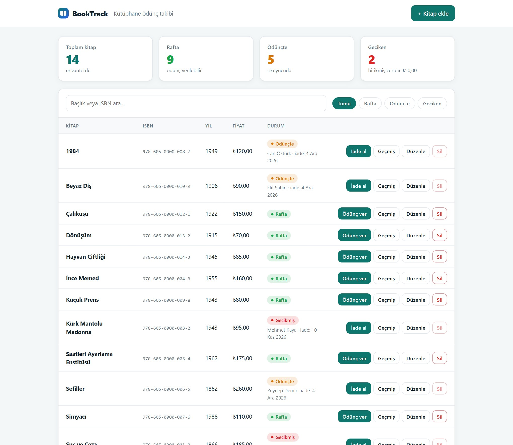
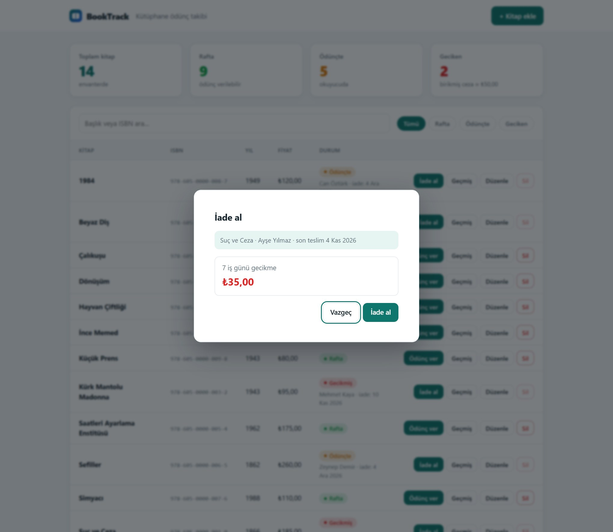
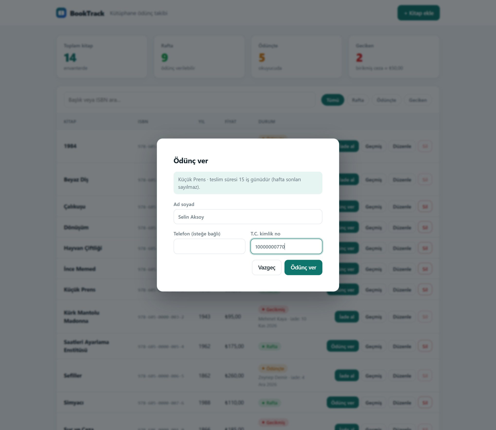
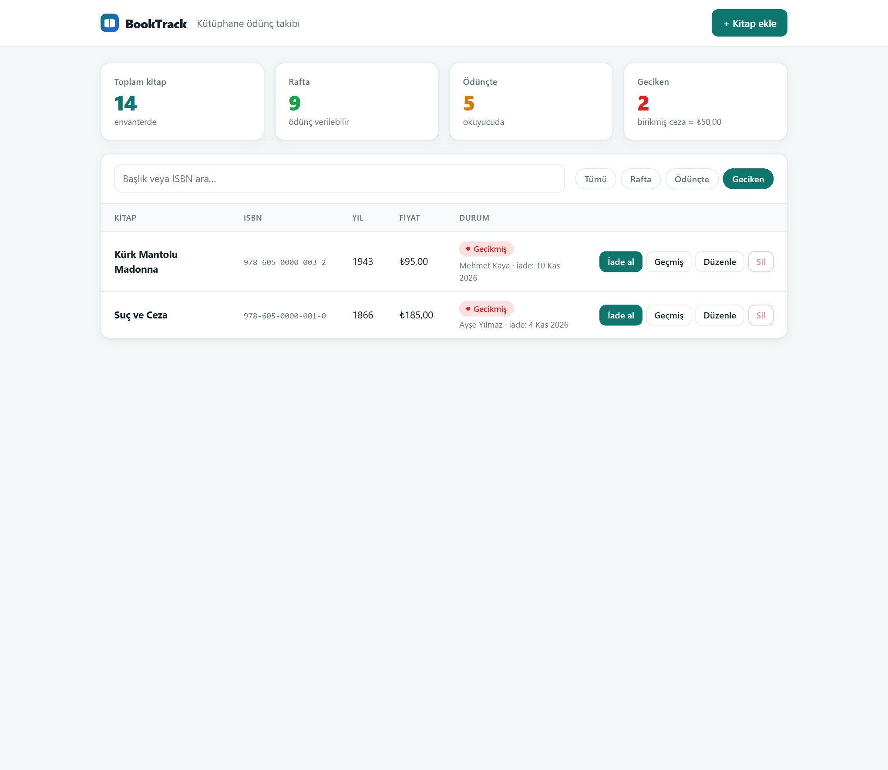
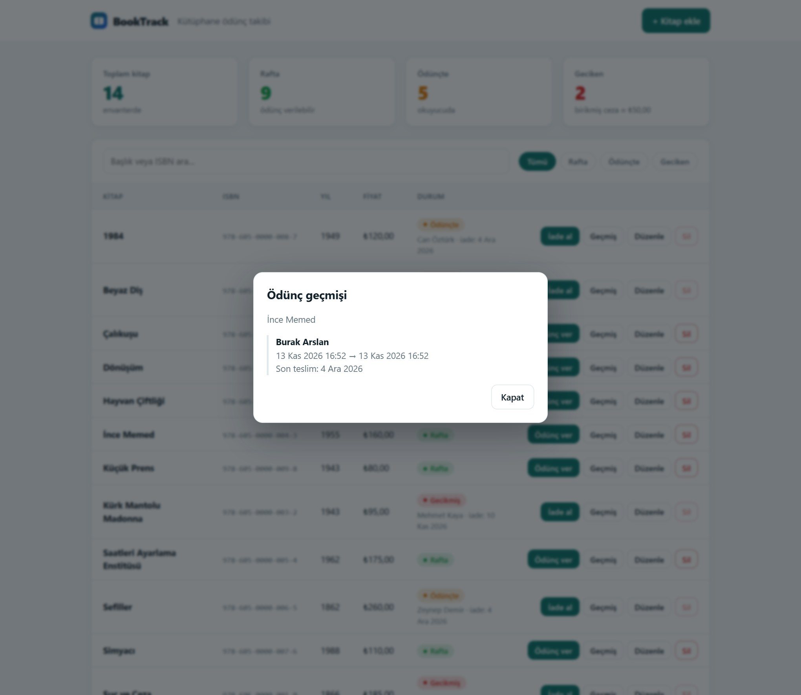
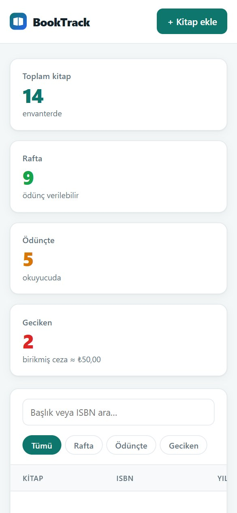

# BookTrack – Kütüphane Ödünç Takip API'si

.NET 8 (ASP.NET Core Web API), Entity Framework Core ve SQL Server ile geliştirilmiş kitap envanteri ve ödünç verme/iade takibi API'si.

 

API ile birlikte gelen web arayüzü (`/`) katalog, ödünç verme, iade ve geçmiş işlemlerini tek ekrandan yapmayı sağlar. API ayrıca Swagger üzerinden denenebilir.



## Web arayüzü
Dosyalar `LibraryApp/LibraryApp/wwwroot` altındadır (sade HTML, CSS ve JavaScript; derleme adımı ve harici bağımlılık yok).

- Üstte özet kartları: toplam, rafta, ödünçte ve geciken kitap sayısı ile birikmiş tahmini ceza
- Başlık veya ISBN ile arama; Tümü / Rafta / Ödünçte / Geciken filtresi
- Kitap ekleme, düzenleme, silme (ödünçteki kitap silinemez)
- Ödünç verme: ad, telefon, T.C. kimlik no doğrulaması; iade alırken gecikme günü ve ceza önceden gösterilir
- Kitap bazında ödünç geçmişi (kişisel veri göstermez)
- Mobilde de kullanılabilir, koyu tema desteği

Güvenlik: metinler `textContent` ile yazılır (`innerHTML` yok), sayfa `Content-Security-Policy` ile sunulur ve satır içi betik/stil kullanmaz.

| İade ve gecikme cezası | Ödünç verme |
|---|---|
|  |  |

| Geciken filtresi | Ödünç geçmişi | Mobil |
|---|---|---|
|  |  |  |

## Özellikler
- Kitap CRUD (`/api/books`); girdiler doğrulanır (başlık ve ISBN zorunlu, yayın yılı 1000–2100, fiyat ≥ 0)
- **Ödünç verme** (`POST /api/books/checkout/{id}`): kitap zaten ödünçteyse reddedilir, teslim tarihi **15 iş günü** sonrası olarak hesaplanır (hafta sonları sayılmaz)
- **İade** (`POST /api/books/checkin/{id}`): gecikme iş günü sayısı üzerinden **günlük 5 ₺ ceza** hesaplanır; yanıtta `lateDays` ve `fine` alanları da döner. Son teslim günü içindeki iade zamanında sayılır; hafta sonları ve resmi tatiller ne teslim süresine ne de cezaya dahil edilir
- Ödünç kaydı (CheckOut) geçmişi tutulur; girdiler doğrulanır (TCKN 11 hane, ad zorunlu)
- EF Core migration'ları, Swagger UI (geliştirme ortamında)

## Uç noktalar
| Yöntem | Yol | Açıklama |
|---|---|---|
| GET | `/api/books`, `/api/books/{id}` | Listele / getir |
| POST | `/api/books` | Kitap ekle |
| PUT | `/api/books/{id}` | Güncelle |
| DELETE | `/api/books/{id}` | Sil |
| POST | `/api/books/checkout/{id}` | Ödünç ver (gövde: ad, telefon, TCKN) |
| POST | `/api/books/checkin/{id}` | İade al, gecikme günü ve cezayı döndür |
| GET | `/api/books/{id}/fine-preview` | İade edilirse şu an uygulanacak gecikme günü ve ceza (iade etmeden önce gösterilir) |
| GET | `/api/books/{id}/history` | Ödünç geçmişi (ad ve tarihler; TCKN ve telefon dönmez) |

## Çalıştırma
Gereksinimler: .NET 8 SDK ve SQL Server (varsayılan bağlantı: `(localdb)\mssqllocaldb`, Windows'ta Visual Studio ile gelir).
```bash
cd LibraryApp/LibraryApp
dotnet ef database update      # veritabanını oluşturur (dotnet tool install --global dotnet-ef)
dotnet run                     # Arayüz: http://localhost:5210  ·  Swagger: /swagger
```
Örnek kitap ve ödünç kayıtlarıyla denemek için uygulama çalışırken: `node scripts/demo-verisi.mjs` (Node 18+; ISBN'ler örnek değerlerdir).

```bash
dotnet test LibraryApp/LibraryApp.sln   # 37 test (SQL Server testleri BOOKTRACK_TEST_SQL tanımlı değilse atlanır)
```
**Resmi tatiller** `appsettings.json` içindeki `Library:Holidays` listesinden okunur (yyyy-MM-dd); 2026 tatilleri tanımlıdır. Listede olmayan bir yıl için tatiller iş günü sayılır, bu yüzden her yıl başında güncelleyin.

Farklı bir SQL Server için `ConnectionStrings:DefaultConnection` değerini değiştirin.

## Testler
xUnit ile 37 test: ödünç süresi ve gecikme hesabı (hafta sonu, resmi tatil ve sınır durumları, `LoanCalculator`), kitap doğrulaması, ödünç verme/iade akışı, gecikme cezası, ödünçteki kitabın silinememesi, geçmiş uç noktasının kişisel veri sızdırmaması ve arayüzün güvenlik başlıkları (`WebApplicationFactory` + bellek içi veritabanı). **Eş zamanlılık:** aynı kitap aynı anda birden fazla kişiye ödünç verilemez. `Book` kaydında SQL Server `rowversion` sütunu vardır; çakışan istekten yalnızca biri başarılı olur, diğeri 409 (veya kitap artık ödünçte olduğu için 400) alır ve reddedilen isteğin ödünç kaydı yazılmaz. Bu davranış bellek içi sağlayıcıyla üretilemediği için gerçek SQL Server'a karşı test edilir (3 test, her biri kendi geçici veritabanını kurar ve siler):
```powershell
$env:BOOKTRACK_TEST_SQL = 'Server=(localdb)mssqllocaldb;Integrated Security=true;TrustServerCertificate=True'
dotnet test LibraryApp/LibraryApp.sln
```
GitHub Actions her push ve pull request'te bir SQL Server servisiyle derleme ve tüm testleri çalıştırır.

## Bilinen sınırlar
Kimlik doğrulama yok (arayüz ve API herkese açıktır; yalnızca güvenli bir ağda çalıştırın); dini bayram tarihleri her yıl değiştiği için resmi tatil listesi yılbaşında güncellenmelidir. TCKN kişisel veridir: üretimde saklama/şifreleme politikası gerekir.

---
*Geliştirici: Emircan Kılıçaslan*